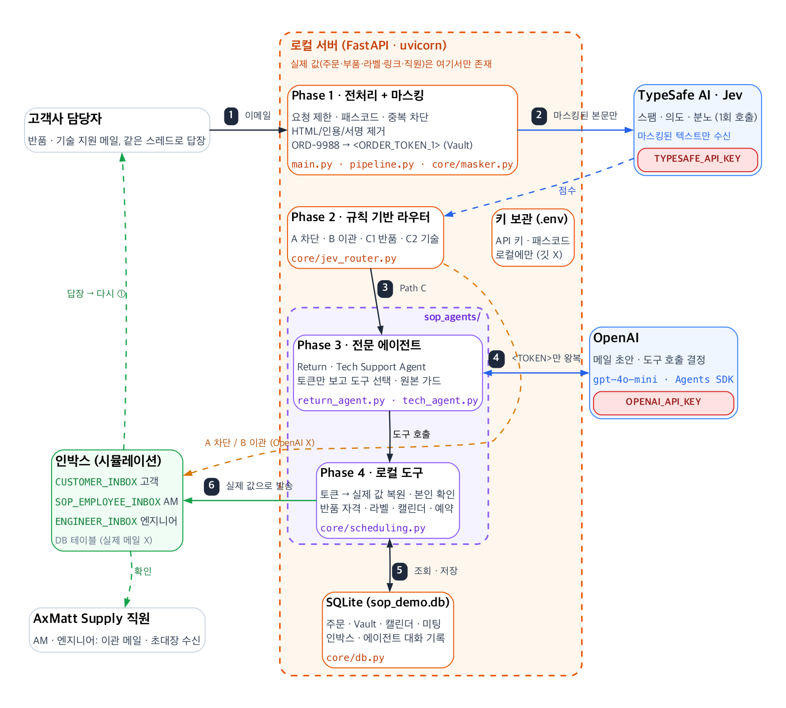

# SOPO Agent

회사의 영업운영(Sales Operation - SOP)팀을 위한 이메일 처리 에이전트

주요 기술 스택: FastAPI + SQLite + Jev + OpenAI Agents SDK

<details>
<summary><b>1. 기술 정보: 준비물 · 로컬 실행 · 샌드박스 사용법</b></summary>

### 준비물

- [uv](https://docs.astral.sh/uv/): Python 3.12(`.python-version`에 고정)와 모든 의존성을 설치합니다.
- TypeSafe AI 키(Jev)와 OpenAI 키.

### 로컬 실행

**1. 의존성 설치**

```bash
uv sync
```

**2. `.env` 만들기**

```bash
cp .env.example .env
```

아래 값을 채웁니다.

```dotenv
DEMO_ACCESS_CODE=pick-any-passcode
TYPESAFE_API_KEY=your-typesafe-key
OPENAI_API_KEY=sk-...
```

`DEMO_ACCESS_CODE`는 필수입니다. 없으면 모든 API 요청이 `503`으로 거부됩니다.

**3. `.env`를 불러오며 서버 시작**

```bash
uv run --env-file .env uvicorn main:app --reload --port 8080
```

앱이 `.env`를 직접 읽지 않으므로, `--env-file .env` 없이 `uv run uvicorn ...`으로 실행하면 키 없이 뜹니다.

**4. 샌드박스(데모 페이지) 열기**

```
http://localhost:8080/?code=pick-any-passcode
```

`?code=`가 패스코드 칸을 자동으로 채웁니다(브라우저에 기억됨). 두 키가 모두 로드되면 상단 바에
**Jev: live**, **OpenAI: live**가 표시됩니다. 키가 없거나 API 오류가 나면 자동 처리하지 않고 사람에게 이관합니다.

### 샌드박스 사용법

화면은 3단입니다.

| 단                   | 내용                                                                                                                                                         |
| -------------------- | ------------------------------------------------------------------------------------------------------------------------------------------------------------ |
| ① Customer Simulator | 보낸 사람, `thread_id`, `message_id`, 이메일 본문, **Send** 버튼                                                                                             |
| ② Backend & AI X-Ray | 단계별 실시간 추적: 원문 vs 마스킹된 텍스트, 로컬 Vault, Jev 점수, 라우팅 결정, 에이전트 도구 호출, 이메일 작성 과정(**⏩ Skip**으로 타이핑 애니메이션 생략) |
| ③ Live Inboxes & DB  | `CUSTOMER_INBOX` / `SOP_EMPLOYEE_INBOX` 카드, `orders`·`thread_vaults` 테이블. Tech 탭에서는 `ENGINEER_INBOX`, 엔지니어·AM 캘린더, `tech_schedules`          |

1. 상단의 탭(**📦 Returns** / **🛠 Tech Support**)을 고르고 시나리오 프리셋을 누르면 ①이 채워집니다
   (새 `thread_id` 생성).
2. **Send**를 누르면 ②에서 처리 과정이 실시간으로 흐르고, 결과 이메일이 ③에 나타납니다.
3. 고객 이메일 카드의 **↩ Reply in Thread**를 누르면 같은 `thread_id`로 답장할 수 있습니다(멀티턴).
4. **Reset DB**는 시드 주문·캘린더를 복원하고 스레드·이메일·에이전트 기록을 지웁니다.
   데모 사이에 누르면 깨끗한 상태에서 시작합니다.

두 탭 모두 같은 엔드포인트로 보냅니다. 어떤 에이전트가 처리할지는 **Jev**가 결정하고, 탭은 프리셋과 ③의
패널만 바꿉니다. 프리셋의 날짜·시간은 시드 캘린더에서 계산되므로, 데모를 며칠 켜 두었다면 **Reset DB**를
누르세요.

**시드 데이터**

| 주문       | 부품      | 소유자                    | 상태              | 배송                     |
| ---------- | --------- | ------------------------- | ----------------- | ------------------------ |
| `ORD-9988` | `AB-1234` | `john@acmecorp.com`       | DELIVERED, 수량 2 | 10일 전 (반품 가능)      |
| `ORD-1111` | `CD-5678` | `john@acmecorp.com`       | DELIVERED, 수량 1 | 45일 전 (30일 기한 초과) |
| `ORD-7777` | `EF-9012` | `mary@betaindustries.com` | SHIPPED, 수량 5   | 아직 미배송              |

- 담당 AM(account manager):
  - John → `sarah.kim@axmattsupply.com`
  - Mary → `david.park@axmattsupply.com`
  - 보안 경고·이관은 공용 큐 `sop-team@axmattsupply.com`으로 갑니다.
- 엔지니어:
  - `alex.chen@`(AB-1234 1순위)
  - `priya.patel@`(AB-1234 2순위, CD-5678)
  - `marco.rossi@`(EF-9012)

</details>

<details>
<summary><b>2. 누구를 위한 에이전트이고, 어떤 업무를 대신하는지</b></summary>

### 누구를 위한 에이전트인가

회사의 영업운영(SOP)팀 내 고객사를 맡고 있는 **어카운트 매니저(AM)** 를 위한 에이전트입니다. 이들은 매일 고객사 구매·엔지니어링 담당자에게서 다음과 같은 이메일을 받아 하나하나 분류하고 처리합니다.

- 반품 요청
- 기술 지원 요청
- 항의
- 스팸이 섞인 이메일

### 어떤 업무를 대신하는가

| 업무                     | 사람이 하던 일                                                                                   | 에이전트가 대신하는 일                                                                                                                                                                                  |
| ------------------------ | ------------------------------------------------------------------------------------------------ | ------------------------------------------------------------------------------------------------------------------------------------------------------------------------------------------------------- |
| **이메일 1차 분류**      | 메일을 읽고 스팸인지, 반품인지, 기술 문의인지, 화난 고객인지 판단                                | Jev가 스팸 확률·의도·분노 지수를 매기고, 규칙 기반 라우터가 차단 / 사람 이관 / 전문 에이전트로 보냄                                                                                                     |
| **반품 처리**            | 주문 조회 → 본인 주문인지 확인 → 반품 기한·수량 확인 → 라벨 발급 → 고객 안내 메일                | Return Agent가 누락 정보 요청부터 3-way 본인 확인, 자격 심사, 라벨 발급(중복 발급 방지), 고객·AM 메일 발송까지 처리                                                                                     |
| **기술 지원 미팅 잡기**  | 부품 담당 엔지니어 찾기 → 엔지니어·AM·고객 일정 맞추기(메일 핑퐁) → 초대장 발송 → 일정 변경 대응 | Tech Support Agent가 구매 이력 확인, 부품 담당 엔지니어 선택, 엔지니어·AM 캘린더 교집합 계산, 고객이 고른 시간으로 예약, 초대장 1통씩 발송, 일정 변경까지 처리. **엔지니어에게는 시간을 묻지 않습니다** |
| **어려운 케이스 넘기기** | 화난 고객, 환불, 사기 의심 메일을 직접 판단                                                      | 사람이 판단해야 하는 건은 요약과 함께 SOP/AM 인박스로 넘기고, 고객에게는 접수 안내 메일 발송                                                                                                            |

### **핵심 원칙: 회사 내부 데이터 및 고객 데이터는 절대 외부 AI에 보내지 않습니다.**

- 주문번호, 부품번호, 반품 라벨, 미팅 링크,직원 이름·이메일은 회사 내부 서버에서 토큰(`<ORDER_TOKEN_1>`, `<PART_TOKEN_1>`, `<LABEL_TOKEN_1>`, `<LINK_TOKEN_1>`)으로 바뀐 뒤에만 Jev·OpenAI로 전달되고, 실제 값은 서버 내 Python 도구 안에서만 복원됩니다. OpenAI 호출 직전과 도구 결과마다 가드가 다시 검사하고, 원본 값이 보이면 즉시 중단하고 사람에게 이관합니다.

</details>

<details>
<summary><b>3. 진행 상황: 지금 되는 것 / 아직 안 되는 것</b></summary>

### ✅ 지금 되는 것

- **공통 파이프라인**
  - 패스코드·IP별 요청 제한, `message_id` 중복 차단, 스레드별 Vault(멀티턴 대화 유지)
  - 지저분한 입력 정규화: `ord/9988`, `ab - 1234` → `ORD-9988`, `AB-1234`
  - Jev 분류 + 규칙 기반 라우팅 : **스팸·프롬프트 인젝션만** OpenAI 비용 $0으로 차단하고, 반품·기술 지원이 아닌 메일(구매 문의, 계정 문의, 타 부서 메일 등)과 분노·환불·저신뢰는 모두 사람에게 이관. 스팸이 아니면 조용히 버려지는 메일은 없음
  - 보낸 사람 로컬 확인: 사내 메일(`@axmattsupply.com`)은 에이전트 없이 SOP로, 자동 응답·`no-reply`·반송 메일은 `[LOW PRIORITY]`로 넘기고 답장하지 않음(메일 루프 방지). 주문 이력이 없는 신규 연락처에는 AM 대신 "담당 팀" 안내 메일
  - 키 누락이나 API 오류 시 fail-closed(사람 이관)
  - Jev & OpenAI 입력과 도구 결과에 대한 원본 데이터 가드
- **Return Agent**
  - 주문번호·부품번호 누락 시 요청 후 같은 스레드에서 이어서 처리
  - 3-way 본인 확인(주문 + 부품 + 보낸 사람). 불일치하면 스레드를 잠그고 `[SECURITY]` 로 AM에게 이관
  - 반품 자격 심사: 배송 완료 여부, 30일 기한, 구매 수량
  - 라벨 발급(`UPS-RMA-{주문번호}`). 이미 발급된 라벨은 재사용
  - 고객 메일에 **샘플 반품 라벨 PDF**(4×6인치) 첨부. 화면 전체에 `SAMPLE / NOT VALID` 표시, 운송사 로고·추적번호 없음, 실제 배송에 쓸 수 없음
  - 고객에겐 반품 메일과 AM에겐 요약 메일 발송
- **Tech Support Agent**
  - 부품 구매 이력 확인, 우선순위에 따른 엔지니어 선택(1순위가 바쁘면 2순위)
  - 구매 이력이 전혀 없는 사람의 기술 문의는 잠재 고객으로 보고 일반 이관(`[SECURITY]`·스레드 잠금 없음)
  - 엔지니어·AM 캘린더 교집합으로 빈 시간 계산
  - 고객이 고른 시간만 예약(에이전트가 임의로 예약하지 않음)
  - 이메일은 엔지니어·AM에게 각 1통, 스레드당 미팅 1개, 고객·부품당 예정 미팅 1개
  - 일정 변경: 같은 스레드 답장이나 새 이메일 모두 가능. 같은 링크 유지, 변경 미팅에 대한 메일 1통
  - 일정 조율 메일 3회 초과 시 사람에게 이관
- **데모**
  - 3단 샌드박스(실시간 X-Ray 스트리밍, Returns/Tech 탭, 프리셋 11개)
  - 실제 이메일 테스트 모드(Resend): 테스터가 개인 메일로 보내고 같은 스레드로 실제 답장을 받음. 샌드박스와 한 서버에서 공존(7번 참고)
  - AM·엔지니어 메일에 고객과의 대화 전체 인용, 대시보드에서 AM·엔지니어가 고객 스레드로 직접 답장(그동안 에이전트 일시 정지), AM·엔지니어 주소로 직접 온 메일도 에이전트가 "SOPO AI Assistant"로 답장

### ⏳ 아직 안 되는 것

**반품(Return)**

- **환불(refund) 자동 처리 없음:** `refund` 의도는 전담 에이전트가 없어 항상 사람에게 이관됩니다 (금액 계산, 크레딧 발행, 회계 연동 없음).
- **이메일 한 통 = 주문 1건 · 부품 1개:** 여러 주문이나 여러 부품을 한 메일로 반품하는 경우(부분 반품 묶음)는 처리하지 않습니다.
- **반품 사유·상태 관리 없음:** 사유(파손/오배송 등)를 구조화해 저장하지 않습니다. 라벨 발급 이후 단계(입고 확인,검수, 재고 반영, 반품 완료 처리)도 없습니다.
- **잘못된 주문번호 반복 시 제한 없음:** 주문번호를 계속 잘못 보내면 매번 다시 요청합니다(Tech 쪽 같은 3회 제한 없음).

**기술 지원 쪽**

- "취소만" 해달라는 요청은 전용 처리 없이 일정 변경 흐름으로 다뤄집니다.

**공통 / 운영**

- 실제 메일은 클로즈드 베타용 테스트 모드뿐입니다: 등록한 테스터의 메일만 처리하고, AM·엔지니어 메일은 공용 테스트 주소(`am@`, `eng@`) 두 곳으로만 갑니다. 회사 메일 계정 연동(OAuth)은 없습니다.
- 구매 문의·견적 자동 처리 없음: 사람에게 이관만 합니다(영업 에이전트 없음). 이관된 메일의 담당자 지정·처리 기한 관리(티켓 시스템)도 없습니다.
- 사내 메일 판별은 보낸 사람 주소의 도메인만 봅니다. 실제 운영에서는 메일 서버의 SPF/DKIM/DMARC 검증과 함께 써야 합니다(사내로 위장해도 사람에게 넘어갈 뿐 권한은 없음).

</details>

<details>
<summary><b>4. 플로우차트</b></summary>



- **① (로컬):** 고객 이메일이 Phase 1로 들어오면 요청 제한·패스코드 확인, 중복 차단 → 전처리 → PII 마스킹. 원본 값은 로컬 Vault에만 저장.
- **② (Jev):** 마스킹된 본문만 보내 스팸·의도·분노 점수를 받고, Python 규칙 라우터가 A(차단) / B(사람 이관) / C(전문 에이전트)로 보냅니다. A·B는 OpenAI 호출 없이 바로 인박스로 갑니다.
- **③ → ④ (OpenAI):** Return / Tech Support Agent는 OpenAI와 `<TOKEN>`만 주고받으며 어떤 도구를 부를지 정합니다.
- **⑤ → ⑥ (로컬 도구):** 본인 확인, 반품 자격, 라벨, 캘린더·예약은 로컬 Python이 SQLite로 처리하고, 실제 값으로 복원한 메일을 인박스(고객·AM·엔지니어)에 넣습니다. 고객이 답장하면 같은 스레드로 다시 ①부터.
- 빨간 배지는 각 외부 서비스가 쓰는 키이며, 키는 로컬 `.env`에만 있습니다.

원본: [`docs/architecture.dot`](docs/architecture.dot)
(`dot -Tpng -Gdpi=140 docs/architecture.dot -o docs/architecture.png`로 다시 생성)

</details>

<details>
<summary><b>5. 구현해 놓은 케이스 (반품 · 기술 지원)</b></summary>

데모 페이지에서는 프리셋 번호로 몇몇 케이스들을 재현했습니다. 그 외에는 이메일 칸에 직접 입력하거나 프리셋을 고친 뒤 보냅니다.

### 📦 반품 (Return Agent)

| #   | 상황                                              | 결과                                                                    | 데모 방법                                                                                         |
| --- | ------------------------------------------------- | ----------------------------------------------------------------------- | ------------------------------------------------------------------------------------------------- |
| R1  | 정상 반품, 지저분한 입력(`ab - 1234`, `ord/9988`) | 반품 라벨 `UPS-RMA-ORD-9988` 발송                                       | Returns 프리셋 1에서 Send 누르기                                                                  |
| R2  | 이미 라벨이 발급된 주문을 다시 요청               | 같은 라벨 재사용(중복 발급 없음)                                        | 프리셋 1에서 Send 한번 더 누르기                                                                  |
| R3  | 주문번호 누락 → 같은 스레드로 답장                | 손님에게 다시 이메일 보내서 주문 번호 물어본 후 확인되면 반품 라벨 발송 | 프리셋 2 에서 Send 누르기 → ↩ Reply in Thread: `It's ord 9988`                                    |
| R4  | 남의 주문으로 반품 요청(스푸핑)                   | `[SECURITY]` 경고 바로 SOP AM에게 알람, 라벨 생성 없음, 스레드 잠금     | 프리셋 3                                                                                          |
| R5  | 반품 기한(30일) 초과                              | 반품 불가 사유 안내 + SOP 통지                                          | 직접 입력: john@ → `I'd like to return CD-5678 from ORD-1111, it stopped working.`                |
| R6  | 아직 배송되지 않은 주문                           | 반품 불가 통지                                                          | 직접 입력: mary@betaindustries.com → `Please send a return label for EF-9012, order ORD-7777.`    |
| R7  | 구매 수량보다 많이 반품                           | 반품 불가 통지                                                          | Reset DB 후 직접 입력: john@ → `I need to return 5 units of AB-1234 from ORD-9988.` (구매 수량 2) |
| R8  | 존재하지 않는 주문번호                            | 다시 확인 요청                                                          | 직접 입력: john@ → `Return AB-1234 from ORD-5555 please.`                                         |
| R9  | 매우 화난 고객                                    | `ESCALATED_TO_HUMAN`, OpenAI 호출 없음                                  | 프리셋 4                                                                                          |
| R10 | 환불 요청                                         | 바로 SOP AM에게 알람 (환불 담당 에이전트 없음)                          | 직접 입력: john@ → `Please refund the $480 we paid for ORD-9988 to our card.`                     |
| R11 | 스팸 / 프롬프트 인젝션                            | Jev에서 차단, OpenAI 비용 $0                                            | 프리셋 5                                                                                          |
| R12 | 같은 `message_id` 재전송                          | 아무 처리 없음                                                          | Send 전에 `message_id`를 복사 → 보낸 뒤 그 값을 다시 붙여넣고 Send                                |

### 🛠 기술 지원 (Tech Support Agent)

| #   | 상황                                                 | 결과                                                                    | 데모 방법                                                                                           |
| --- | ---------------------------------------------------- | ----------------------------------------------------------------------- | --------------------------------------------------------------------------------------------------- |
| T1  | 요청한 시간이 엔지니어·AM 모두 비어 있음             | 고객에게 시간 + 링크, 엔지니어·AM에게 초대 이메일 각 1통                | Tech 프리셋 1                                                                                       |
| T2  | 같은 스레드에서 일정 변경("그 시간 안 돼요, 대신 …") | 미팅 이동, 같은 링크, 고객, AM, 엔지니어 변경 일정 이메일 각각 1통      | 프리셋 1 → ↩ Reply in Thread(힌트 문구 사용)                                                        |
| T3  | **새 이메일**로 일정 변경 요청                       | 기존 미팅을 찾아 이동(중복 예약 없음)                                   | 프리셋 1 Send 이후 프리셋 6 가서 Send                                                               |
| T4  | 시간 언급 없음 → 제안 → 고객이 선택                  | 3개 옵션 제안, **에이전트가 임의로 예약하지 않음**) → 선택 후 미팅 확정 | 프리셋 2 → ↩ Reply: `Option 2 works for us.`                                                        |
| T5  | 요청한 시간에 엔지니어가 바쁨                        | 대안 3개 제안, 엔지니어에게 연락 안 함                                  | 프리셋 3 → 원하면 ↩ Reply로 하나 선택                                                               |
| T6  | 부품번호 누락                                        | 부품번호·희망 시간 요청 → 답장 후 예약                                  | 프리셋 4 → ↩ Reply(힌트 문구 사용)                                                                  |
| T7  | 구매하지 않은 부품으로 미팅 요청                     | SOP AM에게 `[SECURITY]` 경고, 예약·엔지니어 연락 없음                   | 프리셋 5                                                                                            |
| T8  | 존재하지 않는 부품번호                               | 부품번호 재확인 요청                                                    | 직접 입력: john@ → `Our ZZ-0000 unit is failing, can an engineer help?`                             |
| T9  | 제안 시간이 계속 안 맞음(3회 초과)                   | 4번째 조율 메일 대신 AM에게 이관 + 고객 안내                            | 프리셋 2 → ↩ Reply `None of those work, other times?`를 3번(세 번째 답장에서 이관)                  |
| T10 | 이미 예약된 고객·부품으로 새 미팅 요청               | 새로 예약하지 않고 기존 미팅 안내(고객·부품당 1개)                      | 프리셋 1 이후 프리셋 2 보내기(프리셋 1은 특정 시간을 말하므로 일정 변경으로 처리될 수 있음)         |
| T11 | 1순위 엔지니어가 바쁘면 2순위 배정                   | AB-1234: Alex가 바쁜 시간이면 Priya에게 초대                            | 프리셋 1의 시간을 **다음 영업일 오전 10:30**으로 바꿔 보내기(Alex는 바쁘고 Priya·Sarah는 비어 있음) |
| T12 | 화난 고객 / 스팸 (기술 문의라도)                     | 사람 이관 / 차단 (반품과 같은 안전 규칙)                                | 직접 입력: 대문자로 항의하는 기술 문의                                                              |
| T13 | 구매 이력이 전혀 없는 사람(잠재 고객)의 기술 문의          | 일반 이관 + "담당 팀" 안내 메일, `[SECURITY]`·잠금 없음, 엔지니어 연락 없음 | 직접 입력: `buyer@newprospect.com` → `Can an engineer walk us through AB-1234 before we buy?` |

### 📨 그 외 메일 (사람에게 이관)

반품·기술 지원이 아닌 메일은 스팸이 아니면 버리지 않고 모두 SOP로 넘깁니다. 에이전트·OpenAI는 쓰지 않습니다.

| #   | 상황                                          | 결과                                                                                   | 데모 방법                                                                                                   |
| --- | --------------------------------------------- | -------------------------------------------------------------------------------------- | ----------------------------------------------------------------------------------------------------------- |
| O1  | 신규 고객의 구매·견적 문의                    | `ESCALATED_TO_HUMAN`, SOP에 `[ESCALATION] Other inquiry … (no previous orders)`, "담당 팀" 안내 메일 | 직접 입력: `buyer@newprospect.com` → `We're a new company interested in buying 50 AB-1234 units. Can we get a quote?` |
| O2  | 기존 고객의 기타 문의(추가 주문 견적 등)      | SOP 이관, 기존 "AM" 안내 메일                                                            | 직접 입력: john@ → `Could you send me a quote for 10 more AB-1234 units?`                                   |
| O3  | 사내 직원·타 부서 메일                        | SOP에 `[INTERNAL]`, 안내 메일 없음, 반품·예약 같은 처리 없음                               | 직접 입력: `priya.patel@axmattsupply.com` → `FYI: a customer called about returning AB-1234, can someone check?` |
| O4  | 자동 응답·`no-reply`·반송 메일                | SOP에 `[LOW PRIORITY]`, 답장 없음(메일 루프 방지), 열려 있던 스레드 상태는 유지             | 직접 입력: john@ → `Automatic reply: I am out of the office until Monday.`                                  |

</details>

<details>
<summary><b>6. 모든 케이스를 테스트하는 추천 데모 순서</b></summary>

상단의 **Reset DB**로 시작합니다. 각 단계의 "기대 결과"가 ③ 인박스와 상태 배지에 보이면 성공입니다.

### A. 📦 Returns 탭

| 순서 | 할 일                                                                                 | 기대 결과                                                    | 케이스 |
| ---- | ------------------------------------------------------------------------------------- | ------------------------------------------------------------ | ------ |
| 1    | **Reset DB** → 프리셋 **5 · Spam**                                                    | `BLOCKED_SPAM`, 메일 0통, ②에 "Zero OpenAI tokens"           | R11    |
| 2    | 프리셋 **4 · Angry Customer**                                                         | `ESCALATED_TO_HUMAN`, SOP 알림 + 고객 안내, OpenAI 호출 없음 | R9     |
| 3    | 직접 입력(R10 환불 문구)                                                              | `ESCALATED_TO_HUMAN`                                         | R10    |
| 4    | 프리셋 **3 · Spoofed Sender**                                                         | `ESCALATED_TO_HUMAN`, `[SECURITY]`, 라벨 없음                | R4     |
| 5    | 직접 입력(R7 수량 5개)                                                                | `RETURN_DENIED` (구매 수량 2)                                | R7     |
| 6    | 직접 입력(R5 `ORD-1111`)                                                              | `RETURN_DENIED` (45일 전 배송)                               | R5     |
| 7    | 직접 입력(R6 Mary `ORD-7777`)                                                         | `RETURN_DENIED` (미배송)                                     | R6     |
| 8    | 직접 입력(R8 `ORD-5555`)                                                              | 주문번호 재확인 요청                                         | R8     |
| 9    | 프리셋 **2 · Missing Order ID** → 고객 메일의 **↩ Reply in Thread** → `It's ord 9988` | `AWAITING_CUSTOMER_INFO` → `RETURN_LABEL_ISSUED`             | R3     |
| 10   | 프리셋 **1 · Happy Path**                                                             | 같은 라벨 재사용 메시지(9번에서 이미 발급)                   | R2     |
| 11   | **Reset DB** → 프리셋 **1 · Happy Path**                                              | `RETURN_LABEL_ISSUED`, 새 라벨 발급, ②에서 마스킹 확인       | R1     |
| 12   | 프리셋 1을 다시 누르고 `message_id`를 11번에서 쓴 값으로 바꿔 Send                    | `DUPLICATE_IGNORED`                                          | R12    |

> 5번(수량 초과)은 라벨이 발급되기 전에 해야 합니다. 그래서 9–10번보다 앞에 둡니다.

### B. 🛠 Tech Support 탭

| 순서 | 할 일                                                                                             | 기대 결과                                                                           | 케이스 |
| ---- | ------------------------------------------------------------------------------------------------- | ----------------------------------------------------------------------------------- | ------ |
| 13   | **Reset DB** → 탭 전환 → 프리셋 **5 · Not the Owner**                                             | `ESCALATED_TO_HUMAN`, `[SECURITY]`, `ENGINEER_INBOX` 비어 있음                      | T7     |
| 14   | 직접 입력(T8 `ZZ-0000`)                                                                           | 부품번호 재확인 요청                                                                | T8     |
| 15   | 프리셋 **3 · Engineer Busy** (Mary)                                                               | 대안 3개 제안, Marco에게 메일 없음                                                  | T5     |
| 16   | 15번 고객 메일에 **↩ Reply** `Option 1 works.`                                                    | `MEETING_CONFIRMED`, Marco·David에게 초대장 각 1통                                  | T5     |
| 17   | 프리셋 **2 · No Times Given**                                                                     | `AWAITING_CUSTOMER_SCHEDULE`, 3개 제안, **예약 안 됨**                              | T4     |
| 18   | 17번 스레드에 **↩ Reply** `None of those work, other times?`를 3번                                | 첫째·둘째 답장에는 새 제안, 셋째 답장에서 AM 이관 + 고객 안내(`ESCALATED_TO_HUMAN`) | T9     |
| 19   | **Reset DB** → 프리셋 **4 · Missing Part Number** → ↩ Reply(힌트 문구: 부품 + 시간)               | 부품 요청 → `MEETING_CONFIRMED`                                                     | T6     |
| 20   | 프리셋 **2 · No Times Given** (같은 John·AB-1234)                                                 | 새로 잡지 않고 19번 미팅 안내                                                       | T10    |
| 21   | **Reset DB** → 프리셋 **2** → ↩ Reply `Option 2 works for us.`                                    | 제안 → 선택한 시간으로 `MEETING_CONFIRMED`                                          | T4     |
| 22   | 21번 확인 메일에 **↩ Reply** `Sorry, that time no longer works. Could we do <다른 시간> instead?` (`<다른 시간>`은 ③ 캘린더에서 엔지니어·AM 모두 비어 있는 시간) | 미팅 이동, 같은 링크, `[Updated invite]` 각 1통, ③ 캘린더 갱신                      | T2     |
| 23   | 프리셋 **6 · Reschedule (New Email)**                                                             | 새 스레드가 기존 미팅을 찾아 이동, 중복 예약 없음                                   | T3     |
| 24   | **Reset DB** → 프리셋 **1 · Happy Path**                                                          | `MEETING_CONFIRMED`, 초대장 각 1통                                                  | T1     |
| 25   | (선택) Reset DB → 프리셋 1의 시간을 **다음 영업일 오전 10:30**으로 바꿔 Send                      | Priya에게 초대(Alex는 그 시간 고객 방문)                                            | T11    |
| 26   | (선택) 화가 난 기술 문의를 직접 입력                                                              | `ESCALATED_TO_HUMAN`                                                                | T12    |

> 고객·부품당 예정 미팅은 1개만 허용됩니다. 그래서 같은 John·AB-1234 미팅을 새로 잡아야 하는 단계 앞에는 > **Reset DB**가 있습니다.

### C. 📨 그 외 메일 (선택)

| 순서 | 할 일                                       | 기대 결과                                                                 | 케이스 |
| ---- | ------------------------------------------- | ------------------------------------------------------------------------- | ------ |
| 27   | **Reset DB** → 직접 입력(O1 신규 고객 견적 문의) | `ESCALATED_TO_HUMAN`, SOP 알림에 `(no previous orders)`, 고객에게 "담당 팀" 안내 | O1     |
| 28   | 직접 입력(O3 사내 직원 메일)                | SOP에 `[INTERNAL]`, `CUSTOMER_INBOX` 안내 메일 없음                       | O3     |
| 29   | 직접 입력(O4 자동 응답)                     | SOP에 `[LOW PRIORITY]`, 답장 없음                                         | O4     |
| 30   | 직접 입력(T13 잠재 고객의 기술 문의)        | 일반 이관, `[SECURITY]` 없음, `ENGINEER_INBOX` 비어 있음                  | T13    |

</details>

<details>
<summary><b>7. 실제 이메일 테스트 모드 (Resend)</b></summary>

외부 테스터가 **자기 개인 메일**로 `support@<TEST_DOMAIN>`에 메일을 보내고, 에이전트의 답장을 **같은 스레드로** 받는 클로즈드 베타 모드입니다([Resend](https://resend.com) 무료 플랜 사용). 도메인·webhook·환경변수 설정, Cloud Run 배포, 테스트 종료 후 정리는 [docs/README.ko.backup.md](docs/README.ko.backup.md)의 7번을 참고하세요.

### 1) 테스터 초대

1. 테스터에게 `https://<서버 주소>/tester` 링크와 **초대 코드**를 따로 전달합니다.
2. 테스터가 초대 코드와 개인 메일을 입력하면 **개인 대시보드 링크** `/t/<token>`이 발급됩니다. 이 링크가 곧 열쇠이므로 공유하지 말라고 안내하세요(다시 발급되지 않습니다).
3. 대시보드에서 **주문 만들기**(배송 10일 전 = 반품 가능, 45일 전 = 기간 초과)를 누르면 테스터 소유의 주문과 부품이 생기고, 기술 지원용 엔지니어(Alex 1순위, Priya 2순위)도 연결됩니다.
4. "이렇게 보내보세요"의 예시 문구(반품 요청, 주문번호 누락, 기간 초과, 기술지원 미팅, 일정 변경, AM에게 직접 보내기)를 복사해 `support@`(⑥은 `am@`)로 보냅니다. 이어서 대화하려면 받은 답장에 그대로 **답장**합니다.
5. 대시보드는 10초마다 갱신되며, 이 테스터의 스레드에 속한 메일만 보여 줍니다: AM 인박스, 엔지니어 인박스(실제로 수신된 메일, 스레드별로 묶음), 보낸 기록(첨부 📎 포함), X-Ray.

AM·엔지니어가 받는 메일과 사람의 답장:

- AM·엔지니어에게 가는 메일 끝에는 **지금까지의 대화 전체**(고객 메일과 고객이 받은 답장, 최신순)가 전달 메일처럼 인용됩니다. `In-Reply-To`/`References`도 고객 스레드와 같아서, 에이전트가 어떤 메일에 답했는지 바로 보입니다. (미팅 초대장은 고객 확인 메일보다 먼저 나가므로 확인 메일은 들어 있지 않습니다.)
- AM·엔지니어 탭의 스레드마다 **답장 칸**이 있습니다. 여기서 보낸 답장은 고객의 원래 스레드(`Re: 원래 제목`)로 가고, 보낸 사람 이름은 `Sarah Kim (Account Manager) via AxMatt Supply`처럼 표시됩니다.
- 사람이 답장하면 스레드가 **`HUMAN_HANDLING`**(사람이 처리 중)이 됩니다. 이후 고객 메일은 Jev·에이전트를 거치지 않고 자동 답장도 없이 AM(엔지니어가 답했다면 엔지니어도)에게 전달만 됩니다.
- **에이전트에게 다시 맡기기**를 누르면 사람이 맡기 전 상태(예: `MEETING_CONFIRMED`)로 돌아가고, 에이전트가 다시 답합니다.

AM·엔지니어 주소로 직접 보낸 메일:

- 실제 회사에서는 고객이 담당 AM에게 바로 메일을 보내기도 합니다. 등록된 테스터가 `am@`/`eng@`로 보낸 메일은 `support@` 메일과 똑같이 검사(루프·허용 목록·DKIM/DMARC)한 뒤 에이전트가 처리하고, 해당 탭에도 원문이 표시됩니다.
- 답장은 고객이 보낸 주소(`am@` 또는 `eng@`)에서 **`SOPO AI Assistant`** 이름으로 나가고, 본문 끝에 "AI 에이전트가 작성한 답장이며 담당 AM이 이 대화를 보고 있다"는 서명이 붙습니다. AM이 대시보드에서 답장하면 위와 같이 사람이 이어받습니다.
- `support@`가 받는 사람에 함께 있으면 `support@` 메일로 처리합니다. 테스터가 아닌 사람이 `am@`/`eng@`로 보낸 메일은 기존처럼 에이전트가 처리하지 않습니다(서버에만 저장되고 어느 테스터 화면에도 나오지 않음).

샘플 반품 라벨:

- 반품이 승인되면(새 라벨이든 재사용이든) 고객 메일에 `SAMPLE-return-label-<주문번호>.pdf`가 첨부됩니다. 서버에서 reportlab으로 직접 그립니다. 운송사 계정·API·비용이 없고, 할당량도 추가로 쓰지 않습니다.
- 진짜 라벨로 오해되지 않도록 위아래 `SAMPLE — NOT A VALID SHIPPING LABEL` 띠, 대각선 `SAMPLE · VOID` 워터마크, "Not affiliated with UPS" 문구를 넣었습니다. 운송사 로고·실제 추적번호(1Z…)·MaxiCode는 없고, 바코드는 우리 RMA 번호(`UPS-RMA-…`)이며 주소도 샘플입니다.
- 거절·스푸핑·기간 초과에는 첨부가 없습니다. AM 메일에도 첨부하지 않습니다. 샌드박스 고객 인박스 카드와 테스터 보낸 기록에서 📎로 열어 볼 수 있습니다.

처리 규칙:

- 등록되지 않은 주소, 자동 응답(`Auto-Submitted`가 `no`가 아님), `mailer-daemon`·`postmaster`, 우리 도메인에서 온 메일은 처리하지 않고 기록만 남깁니다.
- 같은 이벤트·같은 메일(`email_id`, `Message-ID`)은 한 번만 처리합니다.
- AM·엔지니어 메일은 DB의 직원 정보(Sarah, Alex 등)는 그대로 두고, 발송할 때만 `am@` / `eng@`로 보냅니다. 그래서 엔지니어 우선순위와 캘린더 계산은 샌드박스와 같습니다.

### 2) 할당량 (무료 플랜)

- Resend 무료 플랜은 **보낸 메일과 받은 메일이 같은 할당량**을 씁니다: 하루 100통, 한 달 3,000통. 하루 할당량은 **00:00 UTC**(한국 09:00)에 초기화됩니다.
- 무시된 메일(등록 안 된 발신자, 자동 응답)도 할당량을 씁니다. AM·엔지니어에게 보낸 메일은 발송 1통 + 다시 수신 1통으로 2통이 듭니다.
- 상단 배지: `오늘 남은 이메일: N / 100 · 이번 달: M / 3,000 · 약 K개 시나리오 가능`. 서버는 Resend의 실제 사용량(`GET /usage`, 발송 응답의 `x-resend-daily-quota` 헤더)을 우선 쓰고, 없으면 로컬 기록으로 계산합니다. K는 최근 스레드의 평균 사용량으로 나눈 값입니다(데이터가 없으면 반품 5통·기술지원 7통 기준).
- 남은 수가 20 이하면 주황색, 0이면 "오늘 한도 소진"으로 표시됩니다. 0일 때 들어온 메일은 발송 없이 사람에게 이관되고, 보낸 기록에 `BLOCKED_QUOTA`로 남습니다.

</details>
